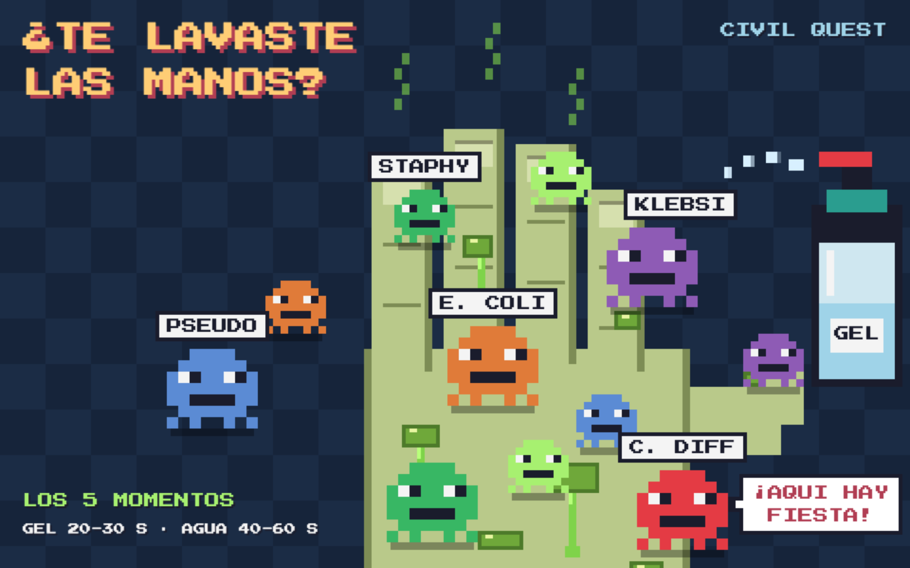

# Civil Quest · Guardianes de la Seguridad del Paciente

Videojuego educativo en pixel art para aprender las **8 Acciones Esenciales para la Seguridad del Paciente** (AESP, CSG/DGCES, actualización junio 2023), ambientado en un turno nocturno del Hospital Civil de Guadalajara.

▶ **Jugar:** https://soorozco.github.io/civil-quest/

## Cómo se juega
1. Recorre el pasillo (flechas/WASD o controles táctiles en celular).
2. Entra a las 8 puertas: cada una es una Acción Esencial con su minijuego.
3. Gana medallas y estrellas.
4. Con las 8 medallas, vence al Auditor de Certificación y obtén tu certificado.

Es un solo archivo HTML, sin instalación. El progreso se guarda en el navegador de cada jugador.

*Juego educativo no oficial. El reglamento interno de cada establecimiento tiene prioridad.*
